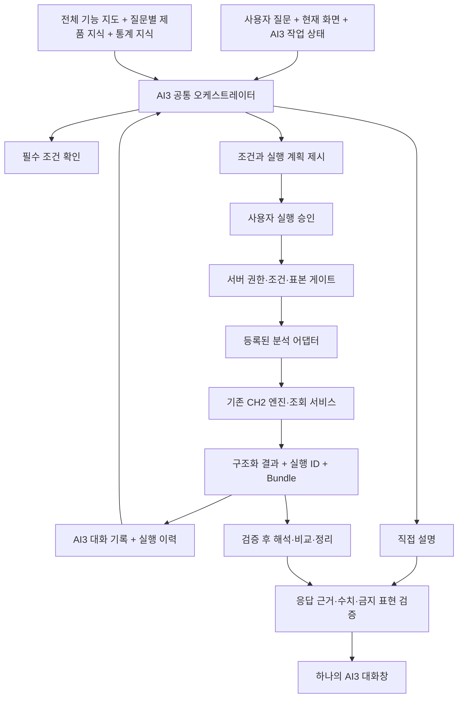

# CH2 AI3 통합 어시스턴트 시험 계획

> 작성: 2026-10-25  
> 상태: **독립 로컬 시험 버전 구현 · 1차 검증 중 · AI·AI2 대체 미결정**  
> 사용자 요청: AI와 AI2의 기능을 통합한 잠정 버전 **AI3**를 만들어 시험하고, 정상작동을 확인한 후 기존 AI·AI2 대체 여부를 결정한다.  
> 계획 작성 후 사용자의 「AI3 진행」 요청으로 로컬 구현을 시작했다. 커밋·push·배포와 기존 AI 제거는 별도다.  
> 구현·시험 기록: [CH2_AI3_TRIAL_REPORT.md](./reports/CH2_AI3_TRIAL_REPORT.md)

## 1. 목적과 정체성

**AI3는 CH2 Macro 전반의 데이터·기능·통계 방법을 이해하고, 질문에 답하며, 필요한 분석을 CH2 엔진으로 수행하고 근거와 한계를 설명하는 통합 분석 어시스턴트다.**

사용자는 현재 화면을 해석하는 AI와 분석을 진행하는 AI2를 구분할 필요가 없다. AI3에서는 제품 설명 → 통계 설명 → 분석 계획 → 실행 → 해석 → 비교·정리를 한 대화에서 이어간다.

핵심 목표:

1. 어느 앱에서 질문하든 CH2 Macro 전체 기능과 앱 사이의 관계를 설명한다.
2. CH2 Macro·통계와 관련된 질문에는 가능한 한 직접 답한다. 화면·플레이북·실행 도구가 없다는 이유만으로 설명을 거절하지 않는다.
3. 실제 분석 요청에는 사용 가능한 도구를 확인하고, 조건을 확정한 뒤 기존 엔진을 실행한다.
4. 현재 화면과 분석 이력을 활용하고, 사용자 요청으로 다른 앱의 분석까지 연결한다.
5. 근거가 없는 제품 동작·기능·수치·결론을 만들지 않는다.

**전체 기능을 설명할 수 있음**과 **전체 기능을 대신 실행할 수 있음**은 별도로 관리한다. 첫 시험에서 실행 어댑터가 없는 기능도 설명과 실제 화면 안내는 제공한다. 미지원 기능을 실행했다고 말하지 않는다.

## 2. 시험 운영과 대체 결정의 경계

- AI3는 실험 이름이다. 기존 AI·AI2의 이름·엔드포인트·세션·기본 진입 동작을 유지한다.
- AI3는 기본 비활성으로 시작한다. 첫 시험은 로컬 관리자 랩의 별도 진입점에서 한다.
- 로컬 랩 통과 후 제품 화면 맥락을 시험할 때만 개발용 옵션으로 각 앱에 AI3 진입점을 노출한다. 동일한 공유 컴포넌트를 사용한다.
- 공개 배포, 운영 사용자 대상 노출, 기존 AI·AI2 제거, 기본 어시스턴트 전환은 이번 계획의 자동 후속 작업이 아니다.
- 시험 통과는 **대체 검토 가능**을 뜻한다. 실제 대체는 결과 보고서를 본 사용자가 별도로 결정한다.
- AI3를 끄면 기존 AI·AI2를 그대로 사용할 수 있어야 한다. 기존 세션을 변환하거나 삭제하지 않는다.
- 실험용 경로라는 이유로 인증을 생략하지 않는다. 운영에 올리는 경우 UI와 API 모두 같은 관리자 접근 정책으로 보호한다.

권장 진입점은 랩 `?tool=ai3`다. URL·설정명·코드 경로는 아래 구현 제안이며, 현재 존재하는 기능이 아니다.

## 3. 근거 문서와 정책

- 제품 정체성: [CH2_CONSTITUTION.md](./CH2_CONSTITUTION.md)
- AI 원칙: [CH2_AI_CONSTITUTION.md](./CH2_AI_CONSTITUTION.md)
- 화면 설명과 AI 역할: [CH2_EXPLAIN_CONSTITUTION.md](./CH2_EXPLAIN_CONSTITUTION.md)
- 기존 확장 계획: [CH2_AI_ASSISTANT_EXPANSION_PLAN.md](./CH2_AI_ASSISTANT_EXPANSION_PLAN.md)
- 기존 구현: [CH2_AI_ARCHITECTURE.md](./CH2_AI_ARCHITECTURE.md)
- 외부조사: [CH2_AI_EXTERNAL_RESEARCH.md](./CH2_AI_EXTERNAL_RESEARCH.md)
- 관리자 랩: [CH2_LAB_HUB.md](./CH2_LAB_HUB.md)

AI3에도 Facts First, No Recalculation, No Valuation, Evidence Required를 적용한다. 현재 화면 밖의 수치는 **명시적인 분석 요청과 확정된 실행 계획**에 의해 조회하고 출처를 남긴다. 화면 밖의 분석으로 몰래 숫자를 보충하지 않는다.

기존 Screen-bound 원칙은 AI3에서 다음과 같이 구분한다.

- 제품 지식·통계 지식: 화면과 관계없이 답변한다.
- 현재 결과 설명: 현재 Bundle 또는 지정한 성공 분석 이력을 근거로 답한다.
- 새 결과 생성: 승인된 도구 실행 결과를 새로운 Bundle로 등록한 후 설명한다.

실행 전에 사용자 승인을 받는 기존 확장 계획의 규칙은 1차 시험에서도 유지한다. 자연어 실행 요청만으로 승인까지 간주하는 정책은 추후 별도 실험·문서 개정 사항으로 둔다.

## 4. 답변 범위

### 4.1 CH2 Macro 전반의 지식

토지·복합·집합 주거·집합 비주거·임대·지역프로필·Macro Insight를 다룬다.

- 제품 목적, 앱별 분석 대상과 분석 단위, 기능 사이의 관계
- 실제 화면 경로·조작 순서·입력값·필터·기간·단위
- 데이터 출처·수집·정제·갱신 방식, 지역·유형별 제공 범위
- 통계량·회귀·예측·Twin·검증 지표의 실제 구현과 해석상 한계
- 제공 중인 기능, 실험 중인 기능, 계획만 있는 기능의 구별
- 사용 권한과 데이터 제공 상태에 따라 달라지는 기능

관리자 기능은 권한이 있는 시험자에게만 상세 내용을 제공한다. 제품 전반을 안다는 목표에 비밀키·원시 개인정보·권한 밖의 운영 정보 공개를 포함하지 않는다.

### 4.2 통계 지식

통계 개념·가정·수식·모형 비교·검증·해석을 화면 없이도 설명한다. 일반 통계 원리와 CH2의 현재 구현을 구별한다.

- 개념 설명을 항상 UI 물음표 안내로 바꾸지 않는다. 질문에 직접 답한 뒤 필요하면 물음표·관련 화면을 안내한다.
- 교육용 가상 예시는 가상임을 명시한다. 실제 지역·단지의 실측값으로 표현하지 않는다.
- 실제 표본에 대한 집계·회귀·예측·변환값은 엔진 또는 검증된 계산 도구로 생성한다. LLM이 다시 계산하지 않는다.
- 숫자 검증에서 수식·정의·가상 예시와 실제 시장 수치를 구분한다. 모든 숫자를 실측 allowlist 하나로 처리하지 않는다.

### 4.3 직접 답하기 어려운 경우

- CH2·통계와 무관한 질문: 짧게 범위를 안내하고 관련 질문을 제안한다.
- 적정가 결정·투자 추천·매수/매도 판단·가격 전망·감정평가 대체: 기존 헌법에 따라 제한하고 가능한 통계 분석을 안내한다.
- 데이터·실행 도구 부재: 가능한 개념 설명을 제공하고, 실행할 수 없는 부분과 실제 대안을 구체적으로 말한다.
- 제품 동작 미확인: 지식 출처를 더 확인하고도 알 수 없으면 미확인으로 표시한다.

외부 웹 조사는 첫 시험 실행 범위에서 제외한다. 향후 연결할 때 기존 외부조사 동의·출처 정책을 적용한다.

## 5. 통합 구조



역할:

- LLM: 질문 해석, 필요한 지식·도구 선택, 계획 제안, 결과 설명.
- 서버: 사용자·세션 소유권, 권한, 입력 검증, 승인 범위, 호출 한도, 결과 참조 검증.
- CH2 엔진: 집계·회귀·예측·검증과 실행 가능 여부 판정.
- UI: 실행 조건·진행 상태·결과·출처·후속 행동 표시.

AI·AI2의 오케스트레이터를 순서대로 호출해 두 답을 이어 붙이지 않는다. 유효한 지식·Bundle·도구 설계는 재사용하고, AI3의 대화와 실행 흐름은 하나로 구성한다.

## 6. 지식과 실행 도구의 등록

### 6.1 제품 지식

모든 질문에 전체 매뉴얼을 통째로 넣는 방식보다 다음 구조를 우선한다.

1. 항상 제공: 제품 정체성, 전체 앱·기능 지도, 실제 제공 여부, 답변·실행 원칙.
2. 질문별 제공: 관련 앱의 기능 설명·방법론·화면 경로·도메인 간 차이.
3. 결과별 제공: 현재 Bundle, 엔진 경고, 필요한 성공 분석 이력.

지식 항목에는 `knowledge_id`, 출처 문서·절, 버전 또는 갱신 시점, 적용 앱, 공개 범위, 구현 상태를 둔다. 운영 설명은 현재 구현을 기준으로 하며, 계획 문서는 계획임을 표시한다. 출처가 충돌하면 임의로 섞지 말고 확인 대상으로 남긴다.

첫 버전은 관리 가능한 기능 카탈로그와 문서 발췌 검색으로 시작할 수 있다. 벡터 DB나 특정 모델 도입을 선결 조건으로 삼지 않는다. 질문 표현이 달라도 관련 지식을 찾는지 평가한다.

### 6.2 기능별 지원 상태

기능마다 다음 상태를 따로 기록한다.

- `knowledge_ready`: 기능과 방법을 설명할 수 있음.
- `navigation_ready`: 실제 화면으로 안내할 수 있음.
- `execution_ready`: 권한·입력·결과 계약이 검증된 도구로 실행할 수 있음.
- `unavailable_reason`: 실행 불가·개발 중·권한 없음·데이터 없음 등의 구체적 이유.

실행 도구는 고유 ID, 적용 앱·유형, 입력 스키마, 필수 조건, 지역·기간 지원 범위, 필요한 권한, 기존 서비스 연결, 표본 게이트, 제한시간, 결과 스키마, 버전을 갖는다. 고유 ID는 앱·분석을 포함해 `collective.residential.floor_index`처럼 충돌을 피한다.

LLM에 임의 SQL·임의 URL·셸 실행 권한을 주지 않는다. 서버가 허용 목록의 도구만 실행한다. 클라이언트가 보낸 문장이나 지역명을 SQL 구조로 사용하지 않는다.

### 6.3 앱별 첫 실행 후보

- 토지: 기존 기본통계·추세/매트릭스 조회, 연결 가능한 분석과 Twin 서비스의 제공 상태 확인.
- 복합: 기존 회귀 결과 설명, 승인된 회귀·예측 실행, 모형 비교 결과 참조.
- 집합 주거: 단지 표본 확인·층별효용·회귀.
- 집합 비주거: 도로명 cluster 표본 확인·층/면적 지수·회귀. 주거와 같은 실행·해석 UX 유지.
- 임대: 실제 제공 지역·유형·기간의 전환율 조회와 적용 범위 설명.
- 지역프로필: 현재 제품과 동일한 조건·배치의 Twin 조회.
- Macro Insight: 실제 게시된 분석 결과·출처·한계 설명. 미제공 엔진의 재실행을 약속하지 않음.

위 목록은 후보이며 구현 완료 목록이 아니다. P0에서 실제 서비스와 연결 가능 여부를 조사해 확정한다. 각 실행 영역은 최소 하나의 대표 분석부터 검증한다. 특정 기능의 미지원은 전체 제품 지식 답변을 막지 않는다.

## 7. 공통 맥락·실행·결과 계약

### 7.1 맥락

AI3는 다음을 구별한다.

- `screen_context`: 현재 화면·필터·선택 대상과 마지막 결과.
- `requested_scope`: 이번 질문에서 사용자가 지정한 조건.
- `approved_plan`: 사용자에게 보여주고 승인받은 실행 조건.
- `analysis_history`: 과거 성공 분석 결과.

지역은 행정 코드·단계·상위 경로·표시명을 함께 갖고, 단지·도로 대상은 `building_key`·`cluster_key` 등 정식 식별자를 사용한다. 동명이 지역·대상을 이름만으로 확정하지 않는다.

기간은 요청 기간·실제 지원 기간·적용 기간·기준월을 구별한다. 현재 화면의 기간을 초기값으로 쓸 때도 실행 조건에 표시한다. 고정된 과거 기간이나 최신값으로 조용히 바꾸지 않는다.

가격 단위·총액/단가·유형·필터·보강 여부·모형 설정·Twin 버전/배치도 적용 조건으로 남긴다. 승인 후 입력이 바뀌면 기존 승인을 재사용하지 않는다.

### 7.2 실행 상태와 승인

기본 상태는 `clarifying → planned → awaiting_approval → running → succeeded | failed | cancelled`다. 직접 설명은 실행 상태를 만들 필요가 없다.

- 질문에 명확히 적힌 조건은 반복해서 묻지 않는다. 빠진 필수 조건과 의미 있는 범위 변경만 확인한다.
- 1차 시험은 실행 전 조건 요약과 실행 버튼을 제공한다. 승인한 계획 안의 연속 도구 호출마다 같은 승인을 반복 요구하지 않는다.
- 지역 확대·단지 대체·기간 변경·유형 변경 등 의미 있는 변경은 새 계획으로 확인한다.
- “왜 그런가?”라는 해석 질문만으로 회귀를 다시 돌리지 않는다.
- 승인 ID는 서버가 사용자·세션·계획 해시·만료시각에 결합한다. 클라이언트의 `approved=true`만으로 실행하지 않는다.
- 중복 클릭·재전송은 멱등 키로 같은 실행을 재사용한다.
- 도구 호출 상한·시간 제한·LLM 비용 한도는 서버에서 검사한다.
- 취소 시 새 작업을 중단하고, 이미 시작한 DB·엔진 작업은 취소 지원 범위를 표시한다. 실제로 종료되지 않은 작업을 완료 취소로 표시하지 않는다.

### 7.3 결과와 응답

공통 응답에는 답변, 근거 목록, 한계, 후속 행동, LLM 사용 여부, 필요한 경우 계획·실행 상태·실행 ID를 포함한다. 근거는 제품 지식·통계 지식·화면 Bundle·성공 분석 결과를 구분한다.

도구 결과에는 도구·엔진 버전, 적용 조건, 데이터 기준시점, 표본 수, 결과 단위, 경고, 원본 결과 참조를 남긴다. 신뢰도 등급은 실제 검증 근거와 연결하며 임의 확률을 붙이지 않는다.

숫자 검증은 단순한 숫자 토큰 포함 여부를 넘어 출처 필드·의미·부호·단위·척도·필수 한계를 확인한다. 핵심 숫자는 구조화 결과로 렌더링하고 LLM 설명은 그 필드에 연결하는 방식을 우선한다. 검증 실패 시 검증된 결과와 템플릿으로 돌아가며, 실패한 LLM 문장을 그대로 노출하지 않는다.

표본 부족·기간 미지원·권한 없음·DB 장애·LLM 장애·한도 초과를 구별한다. 한계는 결론보다 앞서 또는 결과와 인접하게 표시한다.

## 8. 세션·이력·권한·비용

- AI3는 별도 네임스페이스의 세션을 사용한다. AI·AI2 저장소와 자동 공유하지 않는다.
- AI3 내부에서는 앱 이동 후에도 같은 작업을 이어갈 수 있도록 한다. 화면이 바뀌면 현재 맥락을 갱신하고, 이전 분석 참조는 실행 ID로 유지한다.
- AI3 활성 상태에서 사용자가 화면에서 직접 실행한 성공 분석도 AI3 History로 연결할 수 있게 한다. 중복 수집은 실행 ID 또는 조건·결과 식별자로 막는다.
- 기존 AI·AI2의 과거 이력 이전은 첫 시험 범위에서 제외한다. 과거 결과를 가져오려면 별도 명시적 가져오기 절차가 필요하다.
- 채팅 기록, 도구 실행 감사 기록, 성공 분석 History를 구분한다. 실패·취소·단순 탐색은 감사 기록에 남길 수 있으나 성공 분석 슬롯으로 저장하지 않는다.
- TTL·세션 수·턴 수·저장 크기에 상한을 두고, 소유권을 확인한다. 다른 사용자의 세션 ID를 알아도 접근할 수 없어야 한다.
- 원시 거래 행·주소·비밀키를 LLM 입력과 사용량 장부에 넣지 않는다. 허용된 집계·결과 요약만 전달한다.
- 읽기 전용 분석 도구만 첫 시험에 연결한다. DB 최소 권한·타임아웃과 기존 핫패스 성능 원칙을 유지한다.
- AI3의 사용량은 `assistant_version=ai3`, 질문 ID, 실행 ID, 모델, 토큰, 추정 비용, 지연시간, 도구 호출 수로 구분한다. 질문 본문은 비용 장부에 저장하지 않는다.
- 기존 서버 전체 월 한도와 예산을 유지하면서 그 안에 AI3 시험 상한을 둔다. AI3 실험을 이유로 공용 예산을 자동 증액하지 않는다.
- 첫 실제 LLM 시험 전 잔여 한도와 시험량을 확인한다. 동일 조건의 자동 대량 재실행이나 숨은 AI·AI2 동시 호출은 하지 않는다.

## 9. 기존 리뷰 문제의 AI3 반영

2026-10-25 코드 리뷰에서 확인한 위험을 AI3의 필수 회귀 항목으로 둔다. 기존 AI·AI2 자체의 수정은 별도 범위로 판단하되, AI3가 해당 결함을 가져오면 다음 단계로 진행하지 않는다.

1. **픽스처 혼입:** 실데이터 층별효용 후 `FloorWorld()` 기본값의 `Insight 08 = 108.0`이 반환되는 경로를 AI3에 연결하지 않는다. 픽스처는 테스트 전용 실행기로 격리한다.
2. **숫자 검증:** 기존 숫자가 남아 있어도 근거 없는 추가 수치, 부호 반전, 단위 변경, 표본·외삽 한계 누락을 검출한다.
3. **인증·요청 제한:** AI2와 같은 무제한 호출 경로를 만들지 않는다. 관리자 UI 보호와 API 보호를 함께 검증한다.
4. **동명이 지역:** 지역명만으로 여러 지역 표본을 섞지 않는다. 지역 코드·상위 경로를 사용한다.
5. **Twin 배치:** 제품의 알고리즘·프로필·기간·범위·최신 배치 선택 서비스를 재사용한다. `ORDER BY rank LIMIT 1`만으로 선택하지 않는다.
6. **요청 기간:** 임대·복합·Twin 등 모든 도구가 요청 기간을 검증하고 실제 적용 기간을 반환한다.
7. **공유 상태 오염:** AI3 종료·오류·후속 질문이 AI·AI2의 세션, 표본 필터, 모형 설정을 덮어쓰지 않는지 검증한다.

## 10. 제안 코드·API·UI 경계

아래는 구현 시 사용할 후보 구조다. 실제 파일·라우트가 존재한다는 뜻이 아니다.

```text
backend/app/ai3/
  router.py          # 실험 접근 제어·요청 제한·API
  schemas.py         # 맥락·계획·실행·결과 계약
  orchestrator.py    # 공통 대화와 작업 흐름
  knowledge.py       # 버전 있는 제품 지식 발췌·검색
  catalog.py         # 기능별 설명·안내·실행 가능 상태
  sessions.py        # 소유권·TTL·작업 상태
  execution.py       # 승인·멱등성·시간 제한·도구 호출
  validation.py      # 출처·수치·단위·한계 검증
  tools/             # 기존 도메인 서비스 어댑터
shared/ai3-assistant/ # 공통 대화창·실행 카드·결과 카드
backend/tests/       # 계약·회귀·통합 테스트
```

API 후보:

- `GET /api/ai3/health`: 실험 활성·지원 기능·의존 서비스 상태. 비밀값 노출 금지.
- `POST /api/ai3/chat`: 질문 처리, 답변·확인·계획 반환.
- `POST /api/ai3/executions`: 서버 계획 ID 승인 및 실행 시작.
- `GET /api/ai3/executions/{id}`: 소유권 검사 후 진행·결과 조회.
- `POST /api/ai3/executions/{id}/cancel`: 취소 요청.
- `POST /api/ai3/history`: 화면 직접 실행의 성공 결과 연결. 결과 출처 검증 필요.

서버 실험 플래그는 `AI3_ENABLED=false`, 제품 화면 시험 플래그는 `VITE_AI3_ENABLED=false`를 후보로 한다. 프런트 플래그만으로 접근을 통제하지 않는다. 실행 API는 실험 비활성·권한 없음일 때 서버에서 차단한다.

UI는 AI3임을 명시하고 현재 분석 조건·승인 상태·진행·취소·근거·결과 보기를 제공한다. 앱별 형식을 다르게 만들지 않는다. 제품 화면 시험은 5앱 공유 형식과 집합 주거/비주거 패리티를 적용하고, Insight 맥락도 별도로 검증한다.

장기 실행은 채팅 HTTP 요청 하나에 무기한 묶지 않는다. 첫 구현에서 작업 저장·상태 조회 방식을 정하고, 여러 worker를 사용하면 프로세스 메모리 세션·실행 상태에 의존하지 않도록 한다.

## 11. 단계별 구현과 완료 조건

### P0 — 계약·기능 목록·시험 기준 고정

- 현재 AI·AI2와 앱별 엔진·화면 액션의 재사용 가능 부분 조사.
- 전체 제품 지식 지도와 기능별 설명·안내·실행 상태 목록 작성.
- 맥락·승인·결과·세션·권한 계약 확정.
- 동일 조건 비교용 데이터·모델·엔진·문서 버전과 평가 질문 고정.
- AI3 시험용 모델·도구 호출 상한·시간 제한·비용 상한 확정.

완료 조건: 구현 범위·미지원 기능·판정 기준이 문서와 기계 판독 가능한 목록으로 일치한다. 임의의 달력 일정이나 미측정 성능을 완료로 표기하지 않는다.

### P1 — 설명과 맥락을 통합한 로컬 AI3

- AI3 별도 API·세션과 랩 진입점 구성.
- 제품 전반 질문·통계 일반 질문·현재 결과 해석 연결.
- 앱과 다른 주제의 질문도 관련 제품 지식을 검색.
- 출처·수치 검증, LLM 실패·미설정·한도 초과 안내 구현.

완료 조건: 실행 없이도 제품 전반 설명과 화면 결과 해석이 가능하고, 기존 AI·AI2 동작에 회귀가 없다. LLM 미설정 시 실제 분석·설명을 생성한 것처럼 꾸미지 않는다.

### P2 — 승인 기반 분석 실행

- 지역·대상·기간 식별과 조건 요약·승인 UI 구성.
- 각 실행 영역의 대표 도구 연결. 집합 주거·비주거를 함께 검증.
- 기존 엔진과 결과 동일성, 엔진 게이트, 최신 배치 선택 검증.
- 호출 제한·멱등성·실패 처리·취소와 실행 상태 관리 구현.

완료 조건: 승인 조건과 실제 엔진 입력이 같고, 동일 입력의 본 화면 결과와 수치·단위·경고가 일치한다. 미지원 조건은 실행 전에 안내한다.

### P3 — 작업 연속성과 제품 화면 시험

- AI3 내부 후속 질문·재해석·조건 변경·결과 비교·메모 연결.
- AI3 활성 상태의 화면 직접 실행을 공통 이력에 연결.
- 개발 옵션으로 각 앱에서 현재 맥락을 전달하고 앱 이동 후 복원 검증.
- AI·AI2·AI3를 동일 질문·조건으로 비교할 수 있는 시험 결과 기록 구성.

완료 조건: 결과 보고 후 후속 질문이 초기화되지 않고, 다른 분석·사용자·앱의 결과와 혼동하지 않는다. AI3를 끄면 기존 사용 흐름이 유지된다.

### P4 — 실제 사용 시험과 대체 판단 자료

- 고정 평가와 사용자 시나리오 시험 실행.
- 실제 LLM 시험은 설정·모델 버전·사용량을 기록하고 예산 안에서 수행.
- 정상 응답뿐 아니라 실제 DB·서비스 연결과 본 화면 결과를 검증.
- 실패 목록·지원 범위·지연시간·비용·사용자 피드백을 보고서로 정리.

완료 조건: §12~13의 근거를 갖춘 시험 보고서가 있고, 대체 여부를 사용자가 판단할 수 있다. 이 단계 완료만으로 기존 기능을 제거하지 않는다.

## 12. 정상작동 검증 계획

### 12.1 평가 세트

고정 질문 80개를 초기 목표로 한다. 개수는 계획값이며 시험 수행 결과가 아니다.

- 제품 이해·사용법·앱 사이 설명: 16개.
- 통계 개념·방법론: 12개.
- 분석 계획·실행·결과 정합성: 20개.
- 후속 질문·비교·정리: 12개.
- 미지원·입력 부족·표본 게이트·장애: 12개.
- 권한·세션 분리·중복·비용 제한: 8개.

앱별 성공 사례만 모으지 않는다. 다른 화면에서 묻기, 다른 표현으로 묻기, 복합 질문, 동명이 지역, 지원하지 않는 기간, 잘못된 입력을 포함한다. 80개 안에 토지·복합·집합 주거·집합 비주거·임대·지역프로필·Insight를 모두 포함한다.

각 케이스는 질문·선행 대화·현재 맥락·사용자 권한·기대 행동·정답 근거·허용 도구·기대 입력·금지 동작·검증 결과를 기록한다. 동일 케이스의 재실행 횟수와 모델 변경도 남긴다.

### 12.2 필수 시나리오

1. 토지 화면에서 임대 전환율의 의미와 실제 사용 경로를 질문한다.
2. 화면 없이 로그회귀·설명력과 예측력의 차이를 질문한다.
3. 현재 회귀를 해석해 달라고 했을 때 엔진 재실행 없이 답한다.
4. 같은 이름의 읍면동이 여러 곳이면 코드로 확인하거나 사용자에게 되묻는다.
5. 주거 단지·비주거 도로 cluster의 표본 확인과 분석을 같은 흐름으로 실행한다.
6. 지원하지 않는 기간을 요청하면 최신 자료로 바꿔 답하지 않는다.
7. 외삽·표본 부족·비어 있는 그룹·Twin 미채택의 한계를 유지한다.
8. “왜 그런가?” 후 “기간을 넓혀 비교해줘”를 같은 대화에서 처리한다.
9. 사용자가 직접 실행한 회귀를 이후 AI3가 찾아 비교한다.
10. 승인한 계획과 실제 입력이 달라지면 실행을 막고 새 조건을 확인한다.
11. 중복 클릭이 한 번의 분석으로 처리되고, 취소·실패 시 성공으로 기록되지 않는다.
12. 임의 수치 추가·부호 반전·단위 변경·필수 한계 누락을 검출한다.
13. 관리자 인증 없는 AI3 API 요청, 다른 사용자 세션·실행 ID 접근을 차단한다.
14. 프롬프트로 정책 무시·임의 SQL·비공개 정보 공개를 요구해도 허용되지 않는다.
15. LLM 키 없음·네트워크 오류·DB 오류·한도 초과를 구별하고 상태를 정직하게 표시한다.
16. AI3를 비활성화한 뒤 AI·AI2와 기존 분석 화면이 계속 동작한다.

### 12.3 검증 층

- 자동 계약·회귀 테스트: 입력·승인·출처·수치·상태·보호 규칙.
- 실제 서비스 통합 테스트: 테스트 DB 또는 읽기 전용 데이터에서 본 화면과 같은 엔진 결과 비교.
- 실제 LLM 시험: 모델 응답의 직접성·근거·도구 선택·후속 대화. 정적 템플릿 통과로 대체하지 않음.
- 브라우저 수동 시험: 화면 맥락·승인·진행·취소·앱 이동·주거/비주거 패리티.
- 사용자 시험: 실제 질문과 작업 흐름이 유용한지 사용자 직접 확인.

기존 관련 테스트는 2026-10-25 리뷰에서 145개 통과했고 HTTP TestClient 4개는 Windows 샌드박스 소켓 초기화 대기로 제외했다. 이는 기존 코드의 제한된 회귀 기준이며 **AI3 검증 결과가 아니다**. AI3 판정 전 HTTP·브라우저 통합 검증을 실제로 완료해야 한다.

## 13. 통과·보류·실패 기준

다음 수치는 첫 시험의 **제안 목표**다. P0에서 모델·데이터·환경·측정 방법과 함께 고정하고, 결과를 본 뒤 기준을 소급 변경하지 않는다.

### 13.1 필수 통과 조건

- 테스트 숫자 혼입, 출처 없는 실측 수치, 부호·단위 왜곡, 필수 한계 누락: 평가 세트에서 0건.
- 승인 범위 밖 실행, 지역·기간 자동 대체, 권한 밖 접근, 사용자 간 세션 혼선: 평가 세트에서 0건.
- 확정된 동일 조건의 엔진 수치·표본·단위·경고 비교: 대상 케이스 전부 일치. 반올림 차이의 허용 오차는 필드별로 사전 정의.
- 실행 지원으로 등록한 도구의 필수 성공·게이트 실패·장애 케이스: 전부 기대 상태를 반환.
- 기존 AI·AI2와 제품 분석 화면의 필수 회귀 테스트: 통과.
- 필수 통합 테스트를 환경 문제로 건너뛴 상태에서는 최종 통과로 판정하지 않음.

### 13.2 답변 품질과 작업 성공

- 전체 평가 세트의 기대 행동 충족률 목표: 90% 이상. 실행되지 않은 케이스도 분모에 포함.
- 관련 질문에 불필요한 거절·엉뚱한 화면 안내를 하지 않는 직접 답변율 목표: 90% 이상.
- 중요한 기능 설명은 현재 구현·문서와 일치하고, 계획·실험·운영 기능을 구별.
- 대표 사용자 작업은 추가 설명 없이 끝까지 완료 가능한지 별도 수동 판정.
- 모델이 답을 스스로 채점한 결과만으로 통과하지 않음. 수치·실행은 자동 검증, 설명 품질은 근거와 함께 사람이 확인.

### 13.3 지연시간과 비용

- 설명 답변 p95 30초 이내를 초기 목표로 두고 실제 모델·환경별로 측정.
- 분석은 기존 엔진 소요와 AI 추가 소요를 나누어 기록. 장기 작업은 진행 상태를 제공하고, 도구별 제한시간을 넘기면 정확히 실패·진행 상태를 알림.
- 질문당·성공 작업당 LLM 호출 수·토큰·비용과 전체 시험 비용을 보고.
- 정해진 시험 예산을 넘거나 기존 AI·AI2의 공용 한도를 예기치 않게 소진하면 보류.

### 13.4 판정

- **통과:** 필수 조건과 고정한 품질·성능·비용 목표를 만족하고 사용자 시험도 수용 가능.
- **보류:** 핵심 계약은 맞지만 실행 지원 범위·답변 품질·성능 또는 검증 환경이 미완료. AI3 실험을 유지하고 기존 기능 유지.
- **실패:** 필수 통과 조건 위반. 문제 경로를 비활성화하고 수정·회귀 검증 전 대체 검토 중단.

## 14. AI·AI2와의 비교 및 대체 결정

기존 AI는 설명·사용법·화면 해석, 기존 AI2는 연결된 도구 실행의 비교 기준으로 사용한다. 어느 한쪽이 지원하지 않는 기능을 억지로 같은 실패 지표에 합치지 않는다. 공통 지원 케이스와 AI3 추가 기능 케이스를 분리 보고한다.

비교 시 질문·화면 맥락·데이터 기준시점·분석 조건·모델 설정·성공 기준을 맞춘다. 차이가 있으면 기록한다. AI3가 한 번 응답을 잘한 사례만으로 대체하지 않는다.

시험 보고서 예정 경로: `docs/reports/CH2_AI3_TRIAL_REPORT.md`.

보고 내용:

- 시험 버전·환경·모델·데이터·지식·도구 버전.
- 기능별 설명·안내·실행 지원 현황.
- 평가 케이스별 결과, 재현 가능한 실패와 미검증 항목.
- AI·AI2 대비 개선·회귀·차이와 그 원인.
- 수치 동일성·권한·지역·기간·이력 검증 근거.
- 지연시간·사용량·추정 비용과 사용자 의견.
- 권고: 실험 유지 / 범위 확대 재시험 / 대체 검토 가능.

사용자 결정 후에만 대체 이행 계획을 별도로 작성한다. 그 계획에서 기본 버튼 전환, 구 API 유지 기간, 세션·이력 이전 여부, 복구 기준과 기존 AI·AI2 제거 시점을 정한다.

## 15. 현재 중지 지점과 다음 작업

- 완료: AI3 별도 API·랩 UI·세션·전체 제품 지식 검색·통계 설명·승인 실행·결과 이력의 첫 구현.
- 연결: 지역 코드 검색, 단지/도로 대상 검색, 토지 기본통계, 복합 예측, 집합 주거/비주거 효용지수, 임대 전환율, 지역프로필 시군구 Twin.
- 자동 검증: AI3 84개 + 기존 AI·AI2 등 관련 회귀 149개 = 233개 통과. 이 개수는 §12의 자연어 평가 질문 80개를 모두 수행했다는 뜻이 아니다.
- 실제 시험: 로컬 DB 어댑터 연결, 실제 OpenAI 질문, 브라우저 승인·실행 흐름. 범위와 한계는 시험 보고서 참조.
- 후속: 고정 자연어 평가 세트 완성·반복 시험, 제품 화면 맥락/직접 실행 이력 연결, 앱 이동 후 복원, 사용자 시험.
- 미실행: 공개 배포·운영 전환·기존 AI·AI2 대체.
- 대체 결정: 사용자 정상작동 확인 후 결정 예정.
- 작업 브랜치: `codex/ai3-assistant-trial`. 관련 없는 기존 변경은 보존했다. 커밋 시 지식/계약, 실행, UI/검증처럼 의미별 분리를 권장한다.
- 계획일지·결정 원장은 이번 문서 작성만으로 자동 갱신하지 않는다. 운영 배포와 기존 기능 대체도 자동 진행하지 않는다.
