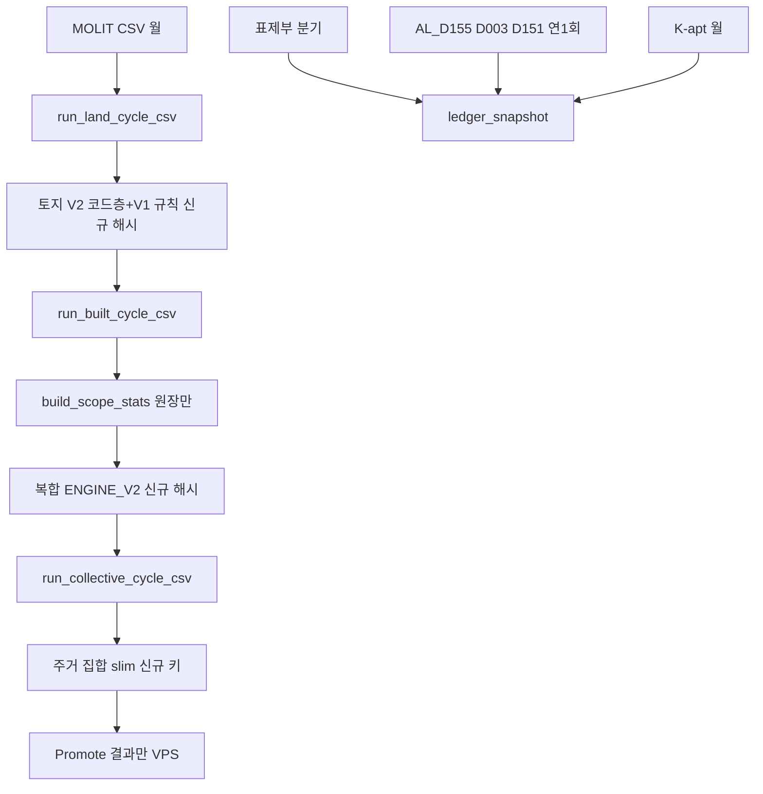

# 축약대장 · 보강 — 월간 운영 SSOT

> 실거래 달은 신규 대장 공급을 기본 실행한다. 운영에는 검증한 결과표를 월간 승격한다.
> 설계: [`PARCEL_MASTER_DESIGN.md`](PARCEL_MASTER_DESIGN.md) §7 · 구현: [`PARCEL_MASTER_IMPLEMENTATION.md`](PARCEL_MASTER_IMPLEMENTATION.md)
> 실거래 러너 SSOT는 그대로 [`MONTHLY_UPDATE_CHECKLIST.md`](MONTHLY_UPDATE_CHECKLIST.md)다. 이 문서는 **대장 달력과 enrich**만 더한다.

제품 서버에는 도메인 결과표를 공급한다. 월간 연결 원천은 로컬 동결 원장과 slim이다.

---

## 1. 한 달에 무엇을 하는지부터 고른다

| 이번 cycle 종류 | 하는 일 | 하지 않는 일 |
|---|---|---|
| **실거래 달** (매월) | MOLIT 12개월 창 재적재, 신규 해시·주거 집합 키 대장 연결, 동결 검증, 결과 promote | 표제부·AL_D* 재다운로드, `parcel_master` dump |
| **K-apt 달** (매월, 실거래와 같은 주) | 단지·PNU 파일 갱신 → `builder_master.pnu` | 표제부 재스캔 |
| **대장 달** (분기) | 표제부·총괄 신본 → `building` 스냅샷 INSERT, `ledger_snapshot` 기록, `--retry-unmatched` | 확정 enrichment 재매칭 |
| **공부 달** (연 1회) | AL_D155 · AL_D003 · AL_D151 적재, 공시지가 마트 최신값 재파생 | 전국 3,900만 필지 |

한 cycle이 실거래+K-apt인 달이 기본이다. 대장 달·공부 달은 체크리스트 0.5에 표시한다.



---

## 2. 원본 달력

근거는 D-047 실측(표제부 월 변화 0.1%p 미만, 용도지역 잔차 0.3~0.4%).

| 원본 | 받는 곳 | 우리 주기 | 폴더 규칙 |
|---|---|---|---|
| 실거래 MOLIT CSV | 국토부 포털 · `molit_csv_collector` | **월** | 체크리스트 1.1 |
| K-apt 기본정보 + 필지고유번호 | 공동주택관리정보시스템 | **월** | `raw/` K-apt 관례 파일. 11MB |
| 건축물대장 표제부·총괄 | 건축HUB `mart_djy_03` / `02` | **분기** | 스냅샷 `YYYY-MM` 3본 유지 |
| 토지이용계획 AL_D155 | 브이월드 | **연 1회** | `AL_D155_{시도}_{배포일}/` |
| 토지대장 AL_D003 | 브이월드 | **연 1회** | `AL_D003_{시도}_{배포일}/` |
| 개별공시지가 AL_D151 | 브이월드 | **연 1회** | `AL_D151_{시도}_{배포일}/` · 광주 `29`·전남 `46`은 적재 시 `12`로 맵핑 |

`ledger_snapshot`이 생기기 전에는 분기·연 1회 재시도를 **수동 플래그** `--retry-unmatched`로만 켠다.

---

## 3. 토지·복합 신규 해시 연결

월간 러너는 원장 재적재 전에 거래 해시 집합을 저장한다. 적재 뒤 **새 해시 중 공급표에 없는 것**만 토지 `LAND_CODE_HISTORY_LAYER_V2+LAND_LINK_RULE_V1` 또는 복합 ENGINE_V2로 계산한다. 같은 해시의 재적재는 신규 거래로 세지 않는다. 격리 worktree에서 복합을 돌릴 때는 기존 표제부·총괄 캐시 경로를 `CH2_BUILT_REGISTER_CACHE` 환경 변수로 지정할 수 있다.

1. 원장·마트 작업 뒤 신규 결과를 한 도메인 트랜잭션으로 삽입한다. 기존 값의 동결을 확인한다.
2. 원장에서 사라진 해시는 토지의 `orphaned`, 복합의 `supply_hold='orphaned'`로 표시한다. 옛 행을 보존하고 새 해시는 독립적으로 연결한다.
3. 결과와 계약월별 연결률은 `clean_snapshots/YYYYMM/ledger_supply/`에 저장한다. 가장 최근 계약월이 직전 3개월 평균보다 10%p 이상 낮으면 경고한다.
4. 실패 시 공급 단계는 롤백하고 월간 작업을 계속한다. `--skip-enrich`는 명시적으로 공급만 건너뛴다.

### 3.1 purge × FK

[`db/068_built_transaction_enrichment.sql`](../db/068_built_transaction_enrichment.sql)은 원래 `REFERENCES built_transactions`였다. [`db/069_built_enrichment_orphan.sql`](../db/069_built_enrichment_orphan.sql)이 FK를 제거한다. CASCADE는 없다.

월간 [`run_built_cycle_csv.py`](../scripts/monthly/run_built_cycle_csv.py): **UPSERT ingest → CSV에 없는 해시만 DELETE**. [`purge_built_contract_window.py`](../pipeline/purge_built_contract_window.py) 기본은 `--keep-hashes-file`. `--delete-all`은 창에 enrichment가 있으면 거절. 국토부가 가격·면적을 고쳐 해시가 바뀌면 옛 보강은 고아, 새 해시는 미상으로 다시 매칭한다.

### 3.2 동결

기본은 `ON CONFLICT DO NOTHING`. 미상만 INSERT한다. 확정 행의 값 변경(B→C)은 새 버전 행 + 명시 승인이다. `is_current`를 자동으로 뒤집지 않는다. 버전 SCD는 P0에 없고 P1 DDL에 자리만 둔다.

| 대상 | 매월 | 이유 |
|---|---|---|
| 신규·정정(새 hash) | 한다 | 증분 |
| 이미 확정된 행 | 하지 않는다 | 스냅샷이 바뀌면 벽돌이 철골이 된다 |
| 미상 재시도 | 대장 달에만 | `ledger_snapshot` 신규 행 또는 `--retry-unmatched` |
| 확정 값 변경 | 하지 않는다 | 승인 없는 rematch·자동 `is_current` 금지 |

---

## 4. 주거 집합 신규 키 연결

아파트·연립다세대·오피스텔의 신규 `building_key`만 현행 대표필지와 동결 slim의 기준연도 가격으로 채운다. 기존 가격은 유지하며 대표필지나 기준연도 가격이 없으면 결측 건수를 기록한다.

K-apt와 표제부 T등급 갱신은 각각 별도 작업이다. 비주거 집합·임대는 월간 대장 공급 범위에서 제외한다.

---

## 5. Promote 경계

| 올리지 않음 | 올릴 수 있음 (게이트 후) |
|---|---|
| `parcel_master` 전체 | `built_transaction_enrichment` |
| 표제부·AL_D* 원본 | `collective_building_attributes` · 공시지가 마트 |
| `_cache/` JSON | 도메인 원장·마트 (현행) |

원본 삭제는 SQL 이관 게이트(2019+ 498,568 · 75.0% · A1/A2 동등) 통과 전 금지. 지금 지우면 `recover_address.py`가 멈춘다.

---

## 6. 검증

[`scripts/monthly/verify_built_enrichment_freeze.py`](../scripts/monthly/verify_built_enrichment_freeze.py). 러너가 마트와 대장 공급 단계 뒤에 호출한다. 값 변경·확정 행 삭제는 실패. 고아·커버리지·상위 용도지역은 리포트(고아는 기본 비실패).

---

## 7. 다운로드 후 적재 명령

실거래 달은 토지 → 복합 → 집합 순으로 실행한다. 주석 줄은 별도 수동 작업이다.

```text
# 실거래 달 — 신규 대장 공급 기본
py scripts/monthly/run_land_cycle_csv.py --cycle-id YYYYMM
py scripts/monthly/run_built_cycle_csv.py --cycle-id YYYYMM
py scripts/monthly/run_collective_cycle_csv.py --cycle-id YYYYMM

# 대장 달 미상(복합) · T 갱신(집합)
# python -m built.recover_from_parcel --sido all --min-year 2019 --retry-unmatched
# python -m parcel_master.apply_title_fill --refresh-t

# 공부 달 공시지가
# python -m collective.import_assessed_land_price --from-slim
```
