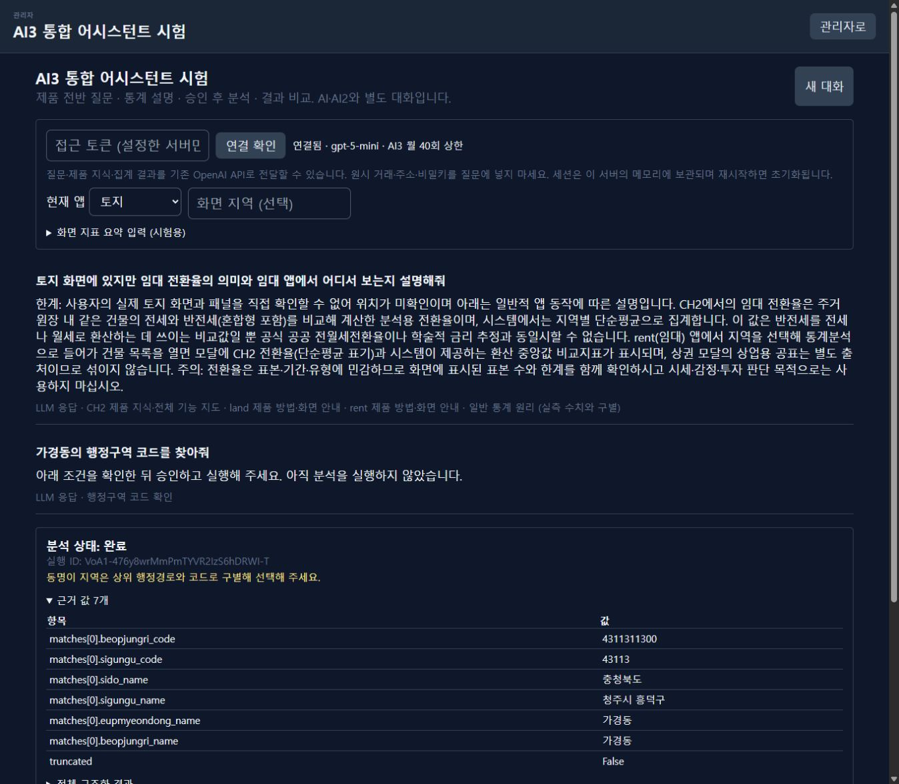

# AI3 독립 로컬 시험 버전 — 1차 구현·검증 기록

> 날짜: 2026-10-25  
> 상태: **사용자 로컬 시험 가능 · 전체 수용시험 미완료 · 대체 판정 보류**  
> 계획: [CH2_AI3_IMPLEMENTATION_PLAN.md](../CH2_AI3_IMPLEMENTATION_PLAN.md)  
> 브랜치: `codex/ai3-assistant-trial` · 미커밋 · 미배포

## 1. 구현한 동작

AI·AI2와 별도의 AI3 API·대화 세션·분석 이력을 만들었다. 기존 AI·AI2의 코드 경로와 기본 버튼은 유지했다.

- 어느 앱 맥락에서도 전체 제품 지도와 관련 앱 지식을 조회해 설명한다. 일반 통계 개념은 화면 없이 설명한다.
- 질문에서 분석 도구와 조건을 계획하거나, 시험자가 도구·조건을 직접 지정한다.
- 서버가 저장한 계획을 화면에서 확인하고 승인한 뒤 실행한다. 승인 요청에 임의의 새 조건을 넣을 수 없다.
- 진행 상태·취소 요청·성공/실패·엔진 경고·구조화 결과·근거 값을 표시한다.
- 성공 실행만 최근 분석 이력에 넣고 후속 설명·비교에 전달한다. 결과 설명만으로 엔진을 다시 실행하지 않는다.
- 지역·대상 이름이 불명확하면 코드/키 검색을 사용할 수 있다. 주소가 들어갈 수 있는 내부 대상키는 세션 전용 불투명 참조로 치환해 LLM에 전달한다.
- API 기본 비활성, 로컬 직접 접근 제한, 외부/프록시 접근 토큰, HttpOnly 소유권 쿠키, 출처 검사, 요청·세션·동시 실행·LLM 호출 한도를 적용했다. 전송 직전 질문·과거 대화의 인증값과 개별 지번/도로 번지를 추가 마스킹한다.

## 2. 연결된 도구

실행 어댑터는 8개다. 실제 사용 가능 여부는 DB·자료·기간·표본·입력 조건을 실행 시 검사한다.

- `regions.search`: 공식 행정명으로 코드·상위 경로 확인.
- `targets.search`: 시도·시군구·읍면동 경로 안에서 단지/도로 cluster 대상 확인.
- `land.basic_stats`: 기존 V2 기본통계·매트릭스 서비스.
- `built.predict`: 기존 복합 예측 서비스. 첫 시험은 명시 연도·행정 경로를 사용하고 보강·시점보정은 제외.
- `collective.residential.index`: 기존 주거 단지 효용지수 서비스.
- `collective.commercial.index`: 기존 비주거 cluster 효용지수 서비스. 주거와 같은 승인·게이트 UX.
- `rent.conversion`: 기존 전환율 조회 서비스. 시도·시군구·유형·기간·기준월을 고정.
- `profile.twins`: 기존 제품의 시군구 Twin 서비스. 알고리즘·프로필·범위·최신 배치 선택 로직 재사용.

AI2의 `FloorWorld`·픽스처·기본 Insight 숫자는 연결하지 않았다. 제공되지 않는 기간으로 자동 변경하지 않는다. Twin 서비스의 기간 폴백도 AI3에서 거절한다.

## 3. 자동 검증

실행 명령:

```powershell
cd D:\ch2\ch2_Macro\backend
.\.venv\Scripts\python.exe -m pytest tests/test_ai3_trial.py tests/test_ai_gateway.py tests/test_ai_planner.py tests/test_ai2_protocol.py tests/test_ai_usage.py tests/test_rent_conversion_ai.py -q --basetemp=.pytest_cache/ai3-privacy-final
```

결과: **233 passed**. AI3 전용 84개와 기존 관련 회귀 149개다. HTTP TestClient를 포함해 실행했으며 제외한 테스트는 없다. 외부 LLM과 실제 DB는 자동 테스트에서 대체했다.

AI3 검증 항목은 기본 비활성, 토큰·출처·Host 보호, 쿠키/세션 소유권, TTL·상한, 계획 만료·교체·승인 입력, 멱등 실행, 실패/취소 이력 분리, 대상키 비식별화, 지역·기간·수치 입력, 부호·단위·숫자 추가 검출, 엔진 어댑터 연결, 후속 설명, LLM 장애·월 상한을 포함한다.

**자동 테스트 84개는 계획의 자연어 평가 질문 80개와 다른 집합이다.** 전체 자연어 평가의 성공률·직접 답변율·p95 목표 달성을 아직 선언하지 않는다.

## 4. 로컬 실제 DB 연결 시험

기존 로컬 설정을 사용하고 읽기 전용 트랜잭션·DB 쿼리 제한시간을 적용했다. 원시 거래·주소는 시험 기록이나 LLM에 내보내지 않았다.

- 지역 코드 검색: 가경동 공식 행정경로·코드 반환 확인.
- 토지: 법정동 코드 `4311311300`, 기준월 `2026-09-01`, 7년 창의 V2 통계 응답 확인.
- 복합: 가경동·2021~2025년·통합 유형·연면적 200·대지면적 150·연식 20의 기존 예측 엔진 응답 확인. 반환 표본 259건. 모형 식별 관련 엔진 경고를 보존했다.
- 집합 주거: 2021~2025년 실제 단지 서비스 응답 확인. 반환 `n_total=50`; 얇은 층 그룹의 지수 미산출 경고 보존.
- 집합 비주거: 같은 연도 조건의 실제 도로 cluster 서비스 응답 확인. 반환 `n_total=48`; 서비스의 정제·그룹 표본 경고 보존. 검색용 전체 건수와 최종 분석 건수는 구분한다.
- 임대: 실제 게이트 통과 자료의 7년 창·기준월 `2026-09-01` 전환율 응답 확인. 임대 URL이 직접 설정되지 않아도 기존 형제 DB 해석을 재사용했다.
- 지역프로필: 시군구 `43113`·3년·전국 범위·일반 프로필의 Twin 응답 확인.

이 시험은 연결과 결과 계약을 확인한 스모크 검증이다. 모든 지역·유형·기간에서 독립적으로 본 화면을 열어 수치를 대조한 전체 수용시험을 대신하지 않는다. 대상 검색의 다양한 도로명·동명이 단지 케이스도 후속 실제 자료 시험이 필요하다.

## 5. 실제 LLM·브라우저 시험

사용자가 질문·제품 지식·집계 결과를 기존 OpenAI API로 전송하는 시험을 명시적으로 허용했다. 설정된 `gpt-5-mini`와 기존 서버 공용 월 한도 안에서 소량 실행했다. AI3 자체 월 호출 상한은 기본 40회다.

- 초기 시험에서 정상 문장도 폴백됐다. 숫자 검증기가 제품명 `CH2`, 지표명 `P50`, 목록 번호를 실측값으로 오인하는 원인을 확인해 수정했다.
- 통계 일반 질문: 설명력과 예측력의 차이를 실제 LLM으로 답하고 출처를 표시하는 것을 확인했다.
- 가상 화면 지표: 표본 73·수정 설명력 0.55를 참조 ID로 읽고, 클라이언트 스냅샷과 엔진 이력을 구별하는 것을 확인했다. 이 지표는 시험용 가상값이다.
- 다른 앱 질문: 토지 맥락에서 임대 전환율의 의미와 임대 앱의 사용 경로를 실제 LLM 응답으로 확인했다.
- 브라우저: 지역 코드 검색의 계획 표시 → 실행 승인 → 진행 상태 → 실제 완료·근거·구조화 결과 표시를 확인했다.
- 자연어 도구 선택: “가경동의 행정구역 코드를 찾아줘”에서 지역 검색 도구·입력을 계획하고, 사용자 승인 후 실제 조회를 완료하는 것을 브라우저에서 확인했다.

오탐 수정·재시험을 포함한 실제 AI3 LLM 호출은 10건, 장부 기준 추정 비용은 약 80원이었다. 전체 평가 세트의 합격률이나 운영 비용 예측값은 아니다.



LLM 해석은 항상 엔진 경고와 구조화 근거 값을 함께 표시한다. 숫자/출처 검증에 실패하면 확인된 지식·결과로 폴백한다. 설명 문장 전체의 의미 정확성을 자동으로 완전히 보장하는 것은 아니므로 후속 평가와 사용자 검토가 필요하다.

## 6. 화면 빌드

- 새 AI3 컴포넌트의 strict TypeScript 검사: 통과.
- 랩 Vite production build: 통과.
- 기존 랩 전체 `tsc`: `docs/lab/built_link_quality_v1_20261017.json`의 392·400·408행에 있는 기존 JSON 구문 문제로 실패. AI3 작업에서 해당 파일을 변경하지 않았다.
- 랩 번들 크기 경고가 있다. 첫 시험은 기존 랩에 별도 진입점을 추가했으며 배포·최적화 완료로 취급하지 않는다.

## 7. 로컬 시험 방법

현재 작업에서 분리 실행한 시험 URL:

- 화면: <http://127.0.0.1:5181/lab/?tool=ai3>
- API: <http://127.0.0.1:8002/api/ai3/health>

기존 API/랩 포트를 중단하거나 `.env`를 변경하지 않았다. 프로세스가 종료되면 다음 명령으로 별도 창에서 다시 실행한다.

```powershell
# API — 단일 worker, 이 프로세스에만 AI3 활성화
cd D:\ch2\ch2_Macro\backend
$env:AI3_ENABLED = 'true'
.\.venv\Scripts\python.exe -m uvicorn app.main:app --host 127.0.0.1 --port 8002
```

```powershell
# UI — 기존 랩과 다른 포트, 별도 API 연결
cd D:\ch2\ch2_Macro\frontend-lab
$env:AI3_API_TARGET = 'http://127.0.0.1:8002'
node node_modules/vite/bin/vite.js --host 127.0.0.1 --port 5181 --strictPort
```

화면에서 제품·통계 질문을 하거나, 하단 도구 입력을 열어 정확한 조건으로 계획을 만든다. 코드·대상키·기준월이 빈 예시는 실제 값으로 채워야 한다. 검색 도구 결과의 `target-…` 참조는 해당 세션에서만 사용할 수 있다.

OpenAI 키는 기존 백엔드 설정을 사용한다. 접근 토큰은 서버에서 설정했을 때만 입력하고 브라우저 저장소·프런트 빌드에 보관하지 않는다.

## 8. 남은 작업과 판정

- 현재 구현은 단일 프로세스 메모리 저장소다. 서버 재시작·페이지 새로고침 뒤의 작업 복원과 다중 worker는 지원하지 않는다.
- AI3 안의 성공 실행 후속 질문은 지원하지만, 제품 화면에서 직접 실행한 분석 가져오기와 앱 이동 후 자동 맥락 복원은 후속이다. 클라이언트의 임의 결과를 성공 엔진 이력으로 등록하는 API는 열지 않았다.
- 전체 제품 지식 지도는 있지만 모든 기능의 실행 도구가 있는 것은 아니다. 회귀·모형추천 등 실행 범위 확장과 실제 지식 커버리지 검증이 필요하다.
- 고정 자연어 평가 세트 완성·반복 시험, 전체 수치 대조, 지연·성공 작업당 비용 측정, 사용자 시험을 이어가야 한다.
- **현재 판정은 독립 로컬 시험 가능이다. 기존 AI·AI2 대체는 보류하며 사용자 확인 후 결정한다.**

커밋·push·운영 배포·계획일지/결정 원장 갱신은 수행하지 않았다.

## 9. 후속 — 제품 화면 내 AI3 모달

2026-10-25 사용자 요청으로 각 유형의 AI3 버튼을 새 탭 링크에서 현재 화면의 대화창으로 바꿨다.

- `shared/ai-assistant/Ai3Assistant.tsx`를 랩과 제품 모달이 함께 사용한다.
- 토지·복합·집합 주거/비주거·임대·지역프로필·Insight에서 같은 창을 연다. 현재 앱·선택 지역을 전달한다.
- 기존 AI 창의 이동·크기 조절 도구를 재사용하고, 닫았다 열어도 대화·진행 상태를 유지한다.
- 개발 프록시는 `/api/ai3`만 별도 시험 API `:8002`에 연결한다. 나머지 앱 API는 기존 대상을 유지한다.
- 관련 7개 프런트의 Vite 빌드 통과. 복합 화면에서 모달 표시·연결과 질문 입력·닫기 동작을 확인했다.

모달 전환은 실행 도구 범위를 확대한 작업이 아니다. 복합 회귀 실행 요청이 설명·재확인만 반복하는 사용자 시험 사례를 확인했다. 현재 카탈로그의 복합 도구는 예측이며, 회귀 실행 도구와 후속 요청의 계획 전환은 별도로 보완해야 한다. 모달 표시 성공을 전체 분석 기능의 통과로 취급하지 않는다.
